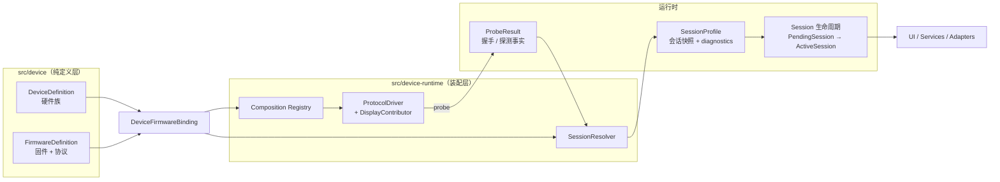
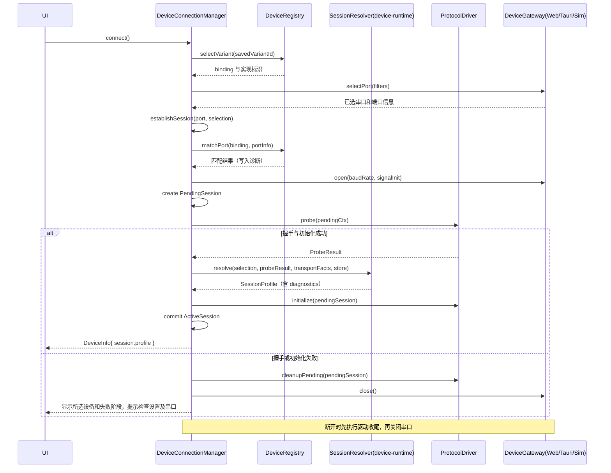

# 设备抽象层重设计：3 类设备 / 4 种固件

> 状态：设计提案（未实施）
> 范围：`web-client`（含 `src-tauri` 的串口参数校验）
> 背景：`add-flashgbx-*` 三个 change 已将 GBFlash（FlashGBX 协议）接入，现有 `FirmwareProfile` 抽象在接入第二类设备时已出现明显的"补丁式扩展"，需要重构。

---

## 1. 现状问题（基于当前代码）

`FirmwareProfile`（`types/firmware-profile.ts`）同时承担了 6 种职责，且以 `id` 字面量联合 `'stm' | 'stc' | 'flashgbx' | 'unknown'` 作为分支依据：

| # | 问题 | 现状证据 | 后果 |
|---|------|----------|------|
| 1 | **设备 / 固件 / 协议混为一谈** | `FirmwareProfileId` 同时表示硬件（丐中丐）、芯片固件（STC）与协议（flashgbx）；Boost 是 `withBeggarBoostProfile()` 对 profile 的运行时"打补丁"（而它在产品上已是第 4 种固件） | 无法表达"同一设备 + 不同固件""同一协议 + 不同设备" |
| 2 | **能力位是扁平布尔且混入协议标识** | `capabilities.nativeFlashgbxProtocol` 实际是"用哪套适配器"的路由开关，不是能力 | UI 用它做 `isFlashgbx` 判断（`CartBurner.vue`、`ChipOperations.vue`、`CartridgeToolsModal.vue`），每加一类设备要全局搜 `=== 'flashgbx'` |
| 3 | **身份判断散落** | `CartBurner.vue` 中 `id === 'flashgbx' \|\| capabilities.nativeFlashgbxProtocol` 出现 3 处（194/315/375）；`CartridgeToolsModal.vue`、`DebugToolModal.vue`、`ChipOperations.vue`、`services/tool-functions.ts`（`isFlashgbxDevice`，4 处调用）、`device-connection-manager.ts` 各有各自的 `isFlashgbx` 判定 | 判定条件不一致即产生 bug |
| 4 | **参数配置按固件 ID 硬编码** | `advanced-settings.ts` 中 `_profileSizes[profile]`、`profile !== 'flashgbx'` 特判、`flashgbxBaudRate` 作为全局字段；`platform-packet-policy.ts` 的 `Record<FirmwareProfileId, …>` | 新增固件需同时改 settings、UI 模态、packet policy 三处 |
| 5 | **连接流程内联分支** | `DeviceConnectionManager.connect()` 内 `isFlashgbx ? … : …` 控制 filter、波特率、`skipSignalInit`、握手、断开序列 | 连接生命周期无法按设备扩展 |
| 6 | **显示信息由组件拼装** | `DeviceConnect.vue` 的 `flashgbxInfo` 展示逻辑硬编码；`DeviceInfo` 直接挂 `flashgbxInfo?: FlashgbxFirmwareInfo` | 协议专有信息泄漏进通用类型；其他设备无法提供同等信息卡 |
| 7 | **适配器选择靠 UI 层 if/else** | `CartBurner.vue.initializeAdapters()` 直接 `new FlashgbxGbaAdapter` / `new GBAAdapter` | 适配器工厂与组件耦合 |
| 8 | **运行时 profile 靠"展开拷贝"** | `buildFlashgbxRuntimeProfile()` spread 静态 profile 再覆盖字段 | 静态定义与运行时事实（握手结果）没有清晰分界 |

**结论**：缺少"设备定义（静态）→ 探测结果（动态）→ 会话上下文（解析后）"这条数据流，以及一个统一的、可声明的扩展点。

---

## 2. 设计目标与非目标

**目标**

1. 用**数据驱动 + 少量策略接口**描述设备，新增设备/固件只需增加声明、binding、runtime composition 注册和本地化文案，不改通用 UI 或连接业务代码。
2. 明确区分四个维度：**硬件（Device）**、**固件（Firmware）**、**协议（Protocol）**、**会话（Session）**。
3. **能力（Capability）**分层、可带条件与原因，UI 只查询能力，不查询身份。
4. **参数配置（Parameter）**声明式：schema 决定默认值、校验、存储、UI 渲染。
5. **显示信息（Display）**由定义提供，通用组件渲染。
6. 向下兼容现有设置存储（localStorage）、现有测试与 Tauri 命令。

**非目标**：除规范明确规定的 GBFlash 目标 `teardown` 安全序列（`CART_PWR_OFF` + `SET_VOLTAGE_3_3V`）外，不改变现有读写/擦除协议字节级行为；不重写 `CartridgeAdapter` / `FlashgbxBaseAdapter` 内部算法（仅改变其构造与选择方式）。

---

## 3. 概念模型

> 术语约定：**设备（Device）= 用户看到的硬件产品；固件（Firmware）= 设备上运行的、决定通信协议与能力的软件；Boost 是独立固件，与 STM 共用同一硬件。**



### 3.1 三类设备 × 四种固件（已确认）

| 设备 (`DeviceDefinition`) | 可搭配固件 | 协议驱动 | 高级设置选项与连接行为 |
|---|---|---|---|
| `beggar-stm` 丐中丐 | `beggar.stm`（标准）、`beggar.stm-boost`（ChisFlash-Beggar-Boost） | `beggar` | 高级设置分别列出「丐中丐」和「丐中丐（Boost）」。选择 Boost 时执行 Boost 握手 |
| `beggar-stc` 碳酸丐 | `beggar.stc` | `beggar` | 选择「碳酸丐」后使用 STC 配置 |
| `gbflash` GBFlash | `flashgbx.cfw`（GBFlash 的 FlashGBX 协议固件，以 `cfwId` + `pcbVer` 区分 PCB 型号） | `flashgbx` | 选择「GBFlash」后使用 FlashGBX 配置，打开串口后通过 `0xA1` 握手验证固件 |

四种固件：**STM、STC、STM-Boost、FlashGBX CFW**。

- Boost 是**丐中丐的独立固件变体**。它通过共享基础固件定义辅助函数复用标准 STM 的协议驱动、适配器和参数配置，并扩展 Boost 握手、transport feature 和读分块上限 `0x2000`。`withBeggarBoostProfile()` 由此删除。
- 「丐中丐（Boost）」选项替代「启用 Boost」开关。两种固件共用 USB 标识，连接时使用用户已选定的变体。Boost 握手失败时，提示用户检查固件或在高级设置切回标准 STM。
- **范围**：仅覆盖 GBFlash 的 FlashGBX 协议固件。**FlashGBX 官方固件及其他硬件（GBxCart RW、Joey Jr 等）不在范围内**；抽象是数据驱动的，将来可新增定义。

核心约束：`DeviceDefinition` 与 `FirmwareDefinition` 可多对多，但每个合法组合必须由 `DeviceFirmwareBinding` 显式登记；UI 和设置只选择一个 `variantId`，不保存可形成非法组合的两个独立值。

---

## 4. 核心类型设计

文件布局拆成两层：`src/device/` 是**纯定义层**，`src/device-runtime/` 是**装配层**。driver、adapter、resolver、display contributor 全部属于装配层，因为它们的职责必然要调用 `protocol/` 与现有适配器实现；纯定义层不得为此开特例。旧 `types/firmware-profile.ts` 保留为兼容门面。

```
src/device/                       # 纯定义层：禁止导入 protocol / services / platform / UI
  types.ts                  # 本节所有接口
  registry.ts               # DeviceRegistry（注册 / 选择 / 匹配）
  capabilities.ts           # CapabilityKey、CapabilitySet 与能力解析纯函数
  parameters.ts             # ParameterSchema、ParameterStore
  display.ts                # DeviceDisplayModel（仅数据模型，不含实现）
  definitions/
    beggar-stm.ts  beggar-stc.ts  gbflash.ts
  compat/firmware-profile.ts# 旧 API 适配（deprecated）

src/device-runtime/               # 装配层：唯一允许同时依赖 device/ 与 protocol/ 的层
  composition-registry.ts   # RuntimeCompositionRegistry：runtimeBindingId → RuntimeBinding
  session-resolver.ts       # SessionResolver：probe facts → SessionProfile
  drivers/
    beggar-driver.ts        # 封装 protocol/beggar_socket 的探测、Boost 检测
    flashgbx-driver.ts      # 封装 protocol/flashgbx 的握手 / 断开
  display-contributors/     # 各固件的 DeviceDisplayModel 构造
  adapters/                 # AdapterFactory 实现（GBA / MBC5）
```

依赖方向固定为：`device-runtime → device`、`device-runtime → protocol`、`device-runtime → services/adapters`，`device` 不得反向依赖 `device-runtime`。`SessionProfile` 的解析放在 `device-runtime`，因为它必须接触协议 facts 与 driver 类型；`src/device/` 只负责注册表、能力规则、参数 schema 和纯数据模型。`scripts/check-architecture-deps.cjs` 按这两条规则分别断言，规则与用例在 core change 的 tasks 1.2 交付。

### 4.1 标识与注册项

```ts
export type DeviceId = string;     // 'beggar-stm' | 'beggar-stc' | 'gbflash' | ...
export type FirmwareId = string;   // 'beggar.stm' | 'beggar.stm-boost' | 'beggar.stc' | 'flashgbx.cfw' | ...
export type ProtocolId = 'beggar' | 'flashgbx';
export type TransportBackend = 'serial' | 'simulated';

/** 硬件定义：描述"这是什么设备"，与固件无关。 */
export interface DeviceDefinition {
  readonly id: DeviceId;
  readonly displayName: DisplayText;
  readonly hardware: HardwareTraits;                    // 纯硬件特性
}

/** 合法的硬件/固件组合，也是 UI 唯一可选择的单位。 */
export interface DeviceFirmwareBinding {
  readonly id: VariantId;                               // beggar-stm / beggar-stm-boost / ...
  readonly deviceId: DeviceId;
  readonly firmwareId: FirmwareId;
  readonly discoveryFilters: readonly UsbDiscoveryFilter[];
  readonly identityMatchers: readonly UsbIdentityMatcher[];
  readonly transport: TransportRequirements;             // transport 静态要求的唯一来源
  readonly parameterNamespace: string;                  // STM 与 Boost 均为 beggar.stm
  readonly runtimeBindingId: RuntimeBindingId;           // composition registry 中唯一实现来源
}

/** 固件定义：描述"设备怎么说话"。 */
export interface FirmwareDefinition {
  readonly id: FirmwareId;
  readonly displayName: DisplayText;
  readonly protocol: ProtocolId;
  readonly baseCapabilities: CapabilityDeclarationMap;
  readonly parameters: ParameterSchema;
}
```

### 4.2 硬件特性、传输需求

```ts
export interface HardwareTraits {
  readonly cartVoltages: readonly ('3.3V' | '5V')[];
  readonly cartPowerControl: 'none' | 'software' | 'auto';
  readonly modeSwitch: 'none' | 'hardware-switch' | 'software';  // GBA/DMG 切换
  readonly cartPresenceDetect: boolean;
  readonly audioWePin: boolean;                                    // 静态默认，可被探测覆盖
}

export interface TransportRequirements {
  readonly defaultBaudRate?: number | 'auto';
  readonly allowedBaudRates?: readonly number[];                   // 与 Rust 白名单同源，见 §8
  readonly signalInit: 'dtr-rts-pulse' | 'none';                   // 取代 skipSignalInit 布尔
  readonly packetLimits: HostPacketLimits;                         // 取代 PLATFORM_PACKET_LIMITS
}

export type HostPacketLimits = Readonly<Record<HostPlatform, {
  romWrite: number; romRead: number; ramPage: number;
}>>;
```

### 4.3 能力模型（Capability）

用**命名空间字符串键 + 三态**替换扁平布尔，并去除"协议路由"伪能力：

```ts
export type CapabilityKey =
  | 'rom.read' | 'rom.write' | 'rom.erase.chip' | 'rom.erase.sector' | 'rom.verify.crc'
  | 'rom.bankSwitch.32M'
  | 'ram.read' | 'ram.write' | 'ram.fram.gba' | 'ram.fram.gbc'
  | 'cart.powerControl' | 'cart.voltageSwitch' | 'cart.presenceDetect' | 'cart.audioWePin'
  | 'tool.rtc.gba' | 'tool.rtc.mbc3' | 'tool.rumble.gba'
  | 'tool.debug' | 'tool.ppbUnlock'
  | 'profile.flashcartDb';

export type CapabilityDeclaration =
  | { state: 'supported' }
  | { state: 'unsupported'; reason?: DisplayText }
  | { state: 'conditional'; ruleId: CapabilityRuleId; reason?: DisplayText };

export type ResolvedCapabilityStatus =
  | { state: 'supported' }
  | { state: 'unsupported'; reason?: DisplayText };

export type CapabilityRuleId =
  | 'gbflash.power-control-present'
  | 'gbflash.audio-write-enabled'
  | 'gbflash.presence-detect-present';
export interface RuntimeFeatures {
  readonly boostTransport: boolean;
}

export type CapabilityDeclarationMap = Partial<Record<CapabilityKey, CapabilityDeclaration>>;
export type CapabilityMap = Partial<Record<CapabilityKey, ResolvedCapabilityStatus>>;

export interface CapabilitySet {
  has(key: CapabilityKey): boolean;                    // resolved supported 才为 true
  explain(key: CapabilityKey): DisplayText | undefined; // 不可用原因（UI 提示 / tooltip）
  all(): ReadonlyMap<CapabilityKey, ResolvedCapabilityStatus>;
}
```

要点：

- **缺省 = unsupported**，避免 `UNKNOWN_FIRMWARE_PROFILE` 把所有能力都设为 `true` 的危险默认。
- **合成顺序**：`HardwareTraits` **不是** `CapabilityMap`，只对 `cart.*` 中确实存在硬件对应项的键（`cart.powerControl`、`cart.voltageSwitch`、`cart.presenceDetect`、`cart.audioWePin`）做硬件门控；`rom.*`、`ram.*`、`tool.*`、`profile.*` 没有硬件层，直接从 `FirmwareDefinition.baseCapabilities` 起步。完整顺序为：`cart.* 硬件门控 → baseCapabilities → probe 收窄`。
- 能力计算是纯函数：缺省/unsupported 不可被 probe 开启；supported 只能被收窄；conditional 由有限 rule ID 求值。能力只代表业务可执行项，路由和实现策略使用 `RuntimeFeatures`。
- `nativeFlashgbxProtocol` 由 composition runtime binding 和 `RuntimeBinding.modeSyncStrategy` 取代；`tool.debug`、`tool.ppbUnlock` 仍是业务能力。

**能力矩阵（规范性）**：四个固件对每个 `CapabilityKey` 的取值见 core change 的 `design.md`「能力矩阵」一节。矩阵是四个固件的 `baseCapabilities` **唯一依据**，注册定义与测试必须与矩阵一致，逐键留空视为不合法。要点：`ram.fram.gba` 在碳酸丐为不可用（现有 `gbaFramRam: false`）；`cart.powerControl` 仅碳酸丐为 supported、GBFlash 为条件；`cart.voltageSwitch`、`cart.presenceDetect`、`cart.audioWePin` 仅 GBFlash，其中后两项分别为条件能力；`tool.debug`、`tool.ppbUnlock` 与 `profile.flashcartDb` 仅 Beggar 或仅 FlashGBX 单侧可用；`tool.rtc.*` 在 FlashGBX 保持 `✓`（保留现有 UI 与服务入口，具体实现待完善）；`rom.bankSwitch.32M` 虽在适配器中有切 bank 实现但暂未接入能力开关，四个固件先按不可用声明并标注待真机确认，迁移期间不得借该键拦截现有 32 MiB 以上切 bank。

### 4.4 协议驱动（ProtocolDriver）

封装 "探测 / 握手 / 初始化 / 断开" 生命周期，取代 `DeviceConnectionManager` 内联分支：

```ts
export interface ProtocolDriver<TFacts> {
  probe(ctx: PendingSessionContext): Promise<ProbeResult<TFacts>>;

  /** 连接后一次性初始化（如 beggar 记录 Boost 模式状态；flashgbx 设置默认电压/模式）。 */
  initialize?(session: PendingSession): Promise<void>;

  /** 断开前的安全序列（flashgbx: CART_PWR_OFF + 3.3V；beggar: 退出 Boost 标记失效）。 */
  teardown(session: ActiveSession): Promise<void>;
  cleanupPending(pending: PendingSession, stage: 'probe' | 'resolve' | 'initialize'): Promise<void>;
}

export interface ProbeResult<TFacts> {
  readonly firmwareId: FirmwareId;
  readonly verification: 'verified' | 'assumed' | 'not-applicable';
  readonly firmwareVersion?: string;
  readonly facts: TFacts;                    // 仅驱动、resolver、display contributor 内部可见
}
```

> [!NOTE]
> 协议专有数据（如 `FlashgbxFirmwareInfo`）放在 `ProbeResult.facts`，由对应驱动与对应 `DisplayContributor` 消费；**`DeviceInfo.flashgbxInfo` 废弃**，改为 public session 的规范化版本、能力、display 与 diagnostics；raw probe facts 不公开。

### 4.5 参数配置（Parameter）

```ts
export interface ParameterDescriptor<T = unknown> {
  readonly key: string;                      // 'romPageSize' | 'baudRate' | 'maxWriteChunk' ...
  readonly kind: 'int' | 'enum' | 'bool' | 'hex';
  readonly default: T;
  readonly constraints?: { min?: number; max?: number; step?: number; options?: readonly T[]; };
  readonly label: DisplayText;
  readonly description?: DisplayText;
  readonly group: 'transfer' | 'connection' | 'advanced';
  readonly scope: 'parameterNamespace' | 'global'; // 存储作用域：binding.parameterNamespace 或 global，不按 binding 各存一份
  readonly linkGroup?: string;                 // 如 'beggar-sizes'，联动时同步同组固件
  readonly requiresReconnect?: boolean;                   // 如波特率
  readonly visibleWhen?: (caps: CapabilitySet) => boolean;
  readonly validate?: (value: T, ctx: ParameterContext) => string | undefined;
}

export type ParameterSchema = readonly ParameterDescriptor[];

export interface ParameterStore {
  get<T>(namespace: string, key: string): T;
  set<T>(namespace: string, key: string, value: T): void;       // 校验失败抛 ParameterError
  snapshot(namespace: string): Readonly<Record<string, unknown>>;
  operationSnapshot(namespace: string): OperationSettingsSnapshot;
  /** 兼容旧 AdvancedSettings 的静态字段。 */
  readonly legacy: LegacySettingsView;
}

/** Core 提供最小可用实现；P3 只迁移它的持久化格式并提供 schema UI。 */
export interface LegacySettingsAdapter {
  readSelection(): VariantId;                 // firmware.profile -> variantId
  readParameter(namespace: string, key: string): unknown;
  writeParameter(namespace: string, key: string, value: unknown): void;
  writeSelection?(variantId: VariantId): void; // v1/v2 共用设置存储后的实现
}

/**
 * 选择结果携带来源；若存储的选择已失效或未注册，返回空选择并由连接入口提示用户重新选择。
 */
export interface SelectionSnapshot {
  readonly variantId?: VariantId;
  readonly source: 'legacy' | 'v2' | 'invalid';
}

export interface SelectionProvider {
  read(): SelectionSnapshot;
  /** P1/P2 只读旧设置；P3 完成 v2 迁移后启用写入。 */
  write?(variantId: VariantId): void;
}
```

存储结构（`localStorage` key `advanced_settings` 新版本 v2，迁移前原 JSON 备份至 `advanced_settings_v1_backup`）：

```jsonc
{
  "version": 2,
  "selectedVariantId": "beggar-stm-boost",
  // 下列数值为 Windows 宿主下的现有默认值（getOptimalPacketLimits），macOS/Linux 为 0xc00；
  // 示例仅表达结构，默认值必须由 schema + 宿主解析得出，不得在迁移中硬编码。
  "parametersByNamespace": {
    "beggar.stm": {
      "romPageSize": 4096, "romReadPageSize": 4096, "ramPageSize": 4096
    },
    "beggar.stc": { "romPageSize": 4096, "romReadPageSize": 8192, "ramPageSize": 4096 },
    "flashgbx.cfw": { "baudRate": "auto", "romPageSize": 256, "romReadPageSize": 256, "ramPageSize": 256 }
  },
  "global": {
    "romReadThrottleMs": 0,
    "defaultTimeout": 3000
    // ...其余 throttle / retry / timeout 全局参数
  },
  "independentSizes": false
}
```

> `independentSizes` 的现有默认值是 `false`（联动）；`beggar.stm-boost` 与 `beggar.stm` 共用同一 namespace，因此 Boost 不需要单独的 `parametersByNamespace` 条目。

这样：

- `_profileSizes[...]` 与 `profile !== 'flashgbx'` 特判被 schema 的 `scope` 与 `visibleWhen` 取代；
- `beggar.stm-boost` 的封包参数与 `beggar.stm` 共用同一 `parameterNamespace`。Boost 读分块上限属于传输实现，由 session transport profile 表达；
- `flashgbxBaudRate` 变为 GBFlash binding namespace 的 `baudRate`，`AdvancedSettingsModal` 只遍历 schema 渲染；
- `pageSize` 上限由各固件 descriptor 的 `constraints.max` 声明（GBFlash 为 `0x2000`，与现有全局 `LIMITS.pageSize.max` 相同，因此行为不变）；P3 后全局校验只做兜底，不再作为唯一来源。
- `independentProfileSizes=false` 时只同步 schema `linkGroup: beggar-sizes`；`true` 时分别保存，FlashGBX 永不入组。

### 4.6 显示信息（Display）

```ts
/** i18n 友好：key + 参数，渲染层再翻译；纯文本给兜底。 */
export type DisplayText =
  | string
  | { readonly key: string; readonly params?: Readonly<Record<string, string | number>>; readonly fallback?: string };

export interface DeviceDisplayModel {
  readonly title: DisplayText;                       // "ChisFlash GBFlash L14"
  readonly subtitle?: DisplayText;                   // 固件版本
  readonly badges: readonly { id: string; text: DisplayText; tone: 'info' | 'success' | 'warn' }[];  // Boost / CDC / CH340
  readonly infoRows: readonly { label: DisplayText; value: DisplayText; copyable?: boolean }[];
  readonly warnings: readonly DisplayText[];         // 例：未实测模式、PCB 无供电控制
}

export interface DisplayContributor<TFacts> {
  build(ctx: InternalResolveContext<TFacts>): DeviceDisplayModel;
}

/** 公开的规范化诊断，取代散落在调用方的日志副作用。 */
export interface DeviceDiagnostic {
  readonly code: string;      // 'port-mismatch' | 'probe-skipped' | 'teardown-failed' ...
  readonly severity: 'info' | 'warning' | 'error';
  readonly message: DisplayText;
  readonly stage?: 'selection' | 'transport' | 'probe' | 'resolve' | 'initialize' | 'disconnect';
}
```

> 泛型参数必须落在 contributor 的**类型**上，而不是 `build` 方法上。`build<TFacts>(...)` 的含义是"这个 contributor 能处理任意 facts"，等于没有类型约束；`DisplayContributor<FlashgbxProbeFacts>` 才能让 FlashGBX 的 contributor 只接受 FlashGBX 的 facts。诊断是公开数据：端口 mismatch、探测跳过、收尾失败都写入 `SessionProfile.diagnostics`，日志只渲染这些诊断，不得成为唯一载体。

`DeviceConnect.vue` 通过右侧日志区（非仅 `console` 输出）以结构化日志形式展示 `profile.display` 中的实际设备、固件变体与端口匹配结果。Boost 徽章、GBFlash PCB 名称和供电信息由各自 contributor 生成。

### 4.7 适配器工厂与 runtime binding

`RuntimeBinding` 把 driver、display contributor 和 facts 类型绑成**一个**类型参数，配错 facts 在定义处就会编译失败：

```ts
export type PlatformId = 'gba' | 'mbc5';

export interface RuntimeBinding<TFacts> {
  readonly driver: ProtocolDriver<TFacts>;
  readonly displayContributor: DisplayContributor<TFacts>;
  readonly adapterFactory: AdapterFactory;
  readonly modeSyncStrategy?: ModeSyncStrategy;
}

/** 装配层持有的查表结果；`resolve` 的泛型参数是本项目唯一的 unknown → TFacts 断言点。 */
export type AnyRuntimeBinding = RuntimeBinding<any>;   // 仅用于注册表存储槽

export interface RuntimeCompositionRegistry {
  register(runtimeBindingId: RuntimeBindingId, binding: AnyRuntimeBinding): void;
  resolve<TFacts>(runtimeBindingId: RuntimeBindingId): RuntimeBinding<TFacts>;
}

// 定义处即闭合：driver 与 contributor 必须是同一 facts 类型。
const flashgbxRuntime: RuntimeBinding<FlashgbxProbeFacts> = { ... };
const beggarRuntime: RuntimeBinding<BeggarProbeFacts> = { ... };
```

`RuntimeBinding<TFacts>` 在编译期闭合 driver 与 display contributor 的 facts 类型，不再额外维护字符串 `factsKind` 交叉校验。`RuntimeBindingId` 的 brand 定义不变。

```ts
export type RuntimeBindingId = string & { readonly __brand: 'RuntimeBindingId' };

export interface AdapterFactory {
  create(platform: PlatformId, ctx: AdapterContext): CartridgeAdapter;
  syncMode?(adapter: CartridgeAdapter, mode: PlatformId): Promise<void>;
}

export interface AdapterContext {
  readonly device: DeviceInfo;
  readonly profile: SessionProfile;
  readonly log: LogCallback;
  readonly updateProgress: ProgressCallback;
  readonly t: TranslateFunction;
}
```

- `beggar` 固件族 → `GBAAdapter` / `MBC5Adapter`（`stm`、`stm-boost`、`stc` 同一族，差异通过 `OperationSettingsSnapshot.values` 与 `capabilities`）。
- `beggar.stm-boost` 通过 composition runtime binding 复用 STM 适配器族，并由 `runtimeFeatures.boostTransport` 启用 Boost 传输扩展。
- `flashgbx` → `FlashgbxGbaAdapter` / `FlashgbxMbcAdapter`。
- `CartBurner.vue.initializeAdapters()` 由 composition registry 按 binding 的 `runtimeBindingId` 解析出的 RuntimeBinding 创建；模式同步策略由同一 RuntimeBinding 注入。

### 4.8 解析后的会话快照

```ts
export interface SessionProfile {
  readonly variantId: VariantId;
  readonly device: DeviceDefinition;
  readonly firmware: FirmwareDefinition;
  readonly firmwareVersion?: string;
  readonly capabilities: CapabilitySet;
  readonly runtimeFeatures: RuntimeFeatures;
  readonly transport: ResolvedTransportProfile;
  readonly verification: 'verified' | 'assumed' | 'not-applicable';
  readonly connectionParameters: Readonly<Record<string, unknown>>;
  readonly display: DeviceDisplayModel;
  readonly diagnostics: readonly DeviceDiagnostic[];   // 端口 mismatch、探测跳过、收尾失败等
}

export interface ResolvedTransportProfile {
  readonly backend: TransportBackend;
  readonly baudRate?: number;
  readonly packetLimits: HostPacketLimits;
}
export interface OperationSettingsSnapshot { readonly values: Readonly<Record<string, unknown>>; }
export interface OperationContext { readonly sessionProfile: SessionProfile; readonly settings: OperationSettingsSnapshot; }
export interface InternalResolveContext<TFacts> {
  readonly device: DeviceDefinition;
  readonly firmware: FirmwareDefinition;
  readonly binding: DeviceFirmwareBinding;
  readonly probe: ProbeResult<TFacts>;
  readonly capabilities: CapabilitySet;
  readonly transport: ResolvedTransportProfile;
  readonly runtimeFeatures: RuntimeFeatures;
}
```

> `SessionProfile` **不可变**，由 `src/device-runtime/session-resolver.ts` 的 `SessionResolver.resolve(selection, probe, transportFacts, store)` 生成，取代 `buildFlashgbxRuntimeProfile()`、`withBeggarBoostProfile()` 这类 spread 补丁。它需要 runtime binding 与 typed facts，因此属于装配层；纯定义层的 `DeviceRegistry` 只做注册、选择与端口匹配。`resolve` 只从 `binding.runtimeBindingId` 取 runtime 实例，驱动不得改写固件身份。
>
> `TransportFacts`、`PendingSession`、`ActiveSession`、`SelectableVariant`、`ParameterError` 的接口定义与能力矩阵一起放在 core change 的 `design.md`，本节不重复维护。

---

## 5. 注册表与解析流程

```ts
export interface DeviceRegistry {
  register(def: DeviceDefinition, fws: readonly FirmwareDefinition[], bindings: readonly DeviceFirmwareBinding[]): void;
  listSelectable(): readonly SelectableVariant[];
  selectVariant(variantId: VariantId): ResolvedVariantSelection;
  forUsbFilters(binding: DeviceFirmwareBinding): SerialPortFilter[];
  matchPort(binding: DeviceFirmwareBinding, port?: SerialPortInfo): 'match' | 'mismatch' | 'unknown';
}

/** 位于 src/device-runtime/，因为要取 runtime binding 并接触 typed facts。 */
export interface SessionResolver {
  resolve<TFacts>(
    selection: ResolvedVariantSelection,
    probe: ProbeResult<TFacts>,
    transportFacts: TransportFacts,
    store: ParameterStore,
  ): SessionProfile;
}
export interface ResolvedVariantSelection {
  readonly variantId: VariantId;
  readonly binding: DeviceFirmwareBinding;
  readonly device: DeviceDefinition;
  readonly firmware: FirmwareDefinition;
  readonly runtimeBindingId: RuntimeBindingId;
  readonly parameterNamespace: string;
  readonly transport: TransportRequirements;
}
```

### 5.1 选择策略

用户在**高级设置**中选定并保存设备和固件变体。连接时应用读取该选项，确定协议、波特率和信号初始化方式。端口信息用于定位串口和记录匹配结果。连接入口只选择串口，设备或固件有误时由用户回到高级设置修改。

| 端口匹配结果 | 连接日志与行为 |
|---|---|
| 匹配 | 记录所选设备、变体及匹配的 VID/PID，按所选配置连接 |
| 不匹配 | 自动发现不得使用；仅用户显式选中端口后才记录提示并按所选 variant 尝试连接 |
| 信息不足 | 自动发现不得视为匹配；只有用户显式选择端口后才按所选 variant 尝试连接 |

GBFlash 的 `1a86:7523` 和 `16c0:27dd` 属于 binding 的 `identityMatchers`；宿主实际支持的 VID/PID 条件另列为 `discoveryFilters`，manufacturer/product 仅用于身份诊断。自动选择只允许 match；mismatch 只有用户显式选中该端口后才可继续。

`beggar-stc` 匹配 `0483:0721`（标准碳酸丐）与 `0483:5740`（RC31）。`0483:5740` 只作为 `beggar-stc` 的 match 规则和其他 Beggar variant 的**手动候选列表线索**（排序与诊断），不改变其他 variant 的 match 判定——选择丐中丐或 GBFlash 时它仍是 mismatch，不参与自动发现。

Web 优先通过 binding 的宿主可过滤 VID/PID 条件筛选浏览器串口列表，同时保留「选择其他串口」入口。Tauri 自动发现只从匹配端口选择；恰有一个匹配时可直接使用，多个匹配时请求用户选择，零匹配时提供完整列表但不得自动打开不匹配端口。用户显式选择 mismatch 端口后直接记录诊断并按已选 variant 尝试连接，不再弹出二次确认。

### 5.2 连接时序



首次连接（`_requestDevice`）、指定串口连接（`connectWithSelectedPort`）和断开后重连共用 `establishSession(port, selection)`。它根据所选固件的 `transport` 和设置打开串口，握手和初始化成功后才发布会话。失败日志包含所选设备、固件、端口匹配结果和失败阶段。

选择 Boost 时，真机探测固定使用 `boost_probe(transport, 250)`；注意 `protocol/beggar_socket/boost-protocol.ts` 的 `boost_enter_mode()` 目前用 `AdvancedSettings.packageReceiveTimeout`（默认 3000），提取驱动时两处必须统一到同一个 250 ms 常量。标准 STM 无身份握手，verification 为 `assumed`，Boost/GBFlash 成功握手为 `verified`。模拟 backend 跳过真机探测并保留底层协议身份。packet limits 统一直接读取 binding 的 `transport.packetLimits`（当前 CH340 与 CDC 数值一致，无需按 USB variant 分表或拒绝 unknown）。Boost 握手失败时 pending cleanup 尝试 `boost_reset_to_default()` 再关闭串口；任何 commit 前失败均不得发布 session。

`runtimeFeatures.boostTransport` 由解析规则唯一决定，不由 lifecycle 手工赋值：`selectedVariantId === 'beggar-stm-boost'` 且（`verification === 'verified'` 或 `transport.backend === 'simulated'`）时为 `true`，其余为 `false`。

迁移期不再保留 `stmBoost` 运行时自动探测分支与 selection 改写逻辑：v1 `stm` 统一迁移到 `beggar-stm`，使用 Boost 固件的用户在高级设置直接选择「丐中丐（Boost）」。

---

## 6. UI / Service 层迁移对照

| 现有代码 | 现状 | 迁移后 |
|---|---|---|
| `CartBurner.vue` `isFlashgbx` ×3 | 身份判断 | `RuntimeBinding.modeSyncStrategy` / `RuntimeBinding.adapterFactory` |
| `services/tool-functions.ts` `isFlashgbxDevice`（4 处调用） | 身份判断，决定 RTC/震动的实现分派与 PPB/debug 拒绝 | 能力查询 `has('tool.rtc.*')` / `has('tool.rumble.gba')` / `has('tool.ppbUnlock')`；实现分派留在会话提供的 runtime binding |
| `CartBurner.vue.initializeAdapters` | `new FlashgbxGbaAdapter(...)` | `runtimeBindingId` 对应 RuntimeBinding 的 adapterFactory |
| `ChipOperations.vue` `nativeFlashgbxProtocol` | 路由开关 | `has('profile.flashcartDb')`、`has('cart.powerControl')` |
| `RamOperations.vue` `gbaFramRam` | 扁平布尔 | `has('ram.fram.gba')`；`explain()` 显示原因 |
| `CartridgeToolsModal.vue` `isFlashgbx` 禁用 RTC/ppb | 身份判断 | `has('tool.rtc.gba')` / `has('tool.ppbUnlock')`，tooltip 用 `explain()` |
| `DebugToolModal.vue` | 对 FlashGBX 禁用 | `has('tool.debug')` |
| `DeviceConnect.vue` 端口筛选 | 由当前固件设置决定 | 根据高级设置筛选串口并记录匹配结果 |
| `DeviceConnect.vue` FlashGBX 信息块 | 写死且仅 `console.info` 输出 | 在右侧日志区渲染 `profile.display`（非仅 `console`） |
| `AdvancedSettingsModal.vue` | 按旧 profile ID 条件渲染 | 提供四个 variant 选项，按 binding namespace 的 schema 生成参数表单 |
| `platform-packet-policy.ts` | `Record<FirmwareProfileId, …>` | `ResolvedTransportProfile.packetLimits`（来自 `binding.transport.packetLimits`） |
| `cartridge-adapter.ts` `profileKey = id === 'stc' ? 'stc' : 'stm'` | 硬编码 | 读取 `OperationSettingsSnapshot.values` |
| `getFirmwareProfile(device)` | 三层兜底推断 | `device.session.profile`（唯一来源），无 session 即未连接 |

---

## 7. 向后兼容与迁移策略

按五阶段实施，以当前 89 个 `*.test.ts` 测试文件作为回归基线（用例数在动工前用 `npm run test:run` 记录实际值，不沿用旧文档中的 1125）。core 在 P1 提供 legacy-backed SelectionProvider 与 ParameterStore 后，lifecycle 可在 P2 独立交付；P3 再切换 v2 持久化格式并提供 UI。

| 阶段 | 内容 | 风险 | 验证 |
|---|---|---|---|
| **P0 骨架** | 新增 `src/device/`（类型、registry、capability/parameter）与 `src/device-runtime/` 骨架（composition registry、`SessionResolver`，driver 用测试桩），**不接线** | 低 | 新单测（capability 解析、schema 校验、registry 匹配） |
| **P1 定义落地 + 兼容门面** | 编写 4 个定义；`types/firmware-profile.ts` 改为从 `SessionProfile` 派生旧 `FirmwareProfile`（`@deprecated`）；`getFirmwareProfile()` 内部走新路径 | 中 | 旧测试零修改通过 |
| **P2 连接与适配器** | 在 `src/device-runtime/` 提取 `BeggarDriver` / `FlashgbxDriver`、display contributor 与 adapter factory，集中会话建立路径，`CartBurner` 用 adapterFactory | 中高（真机相关） | 验证自动发现只选择 match，mismatch/unknown 仅用户显式选择后才可连接，Tauri 多个匹配端口时请求选串口。验证 Boost 失败复位和 GBFlash L14 真机回归 |
| **P3 设置与 UI** | ParameterStore 的 v2 storage adapter 与 v1→v2 migration，schema 表单和 legacy alias 清理，开放独立 Boost 选项，`AdvancedSettingsModal` 渲染 schema | 中 | 设置迁移、独立变体选择、共用 STM 封包设置，i18n 5 语言键完整性检查 |
| **P4 清理** | 删除 `nativeFlashgbxProtocol`、`withBeggarBoostProfile`、`DeviceInfo.flashgbxInfo`、`AdvancedSettings.flashgbxBaudRate` 兼容别名 | 低 | lint 规则禁止 `.id === '`/`firmwareProfile?.id` |

设置迁移（v1→v2）规则：

- `firmware.profile` → registry 对应的单一 variantId；v1 阶段只读，v2 migration 后写 `selectedVariantId`。`stm` 对应 `beggar-stm` / `beggar.stm`，`stc` 对应 `beggar-stc` / `beggar.stc`，`flashgbx` 对应 `gbflash` / `flashgbx.cfw`。
- 旧 `firmware.stmBoost` 不再触发兼容探测或一次性弹窗标记。迁移后丐中丐统一对应标准 STM 选项，使用 Boost 固件的用户在高级设置选「丐中丐（Boost）」。两种选项继续共用迁移后的 STM 封包设置。
- `profileSizes[x]` → 对应 binding 的 `parameterNamespace` 参数空间。
- `flashgbxBaudRate` → GBFlash binding 的参数 namespace 中 `baudRate`。
- 迁移时尽力备份一次旧 JSON（`advanced_settings_v1_backup`，失败忽略）并写入 v2；读到损坏 JSON 或未知版本直接回退默认值运行，不阻断启动或写回损坏源。

保持不变的外部契约：`DeviceSelection.baudRate`、`DeviceHandle.skipSignalInit`（由 `signalInit` 派生）、Tauri `native_platform.rs` 命令签名。

---

## 8. Rust 侧与 Transport 契约

- 波特率白名单当前仅在 `native_platform.rs`（`{9600, 1000000, 1500000, 2000000}`，默认 9600）。决定：**仍以 Rust 为强制校验**，前端在 `src/device/` 维护 `ALLOWED_BAUD_RATES` 常量（注明须与 `native_platform.rs` 一致），仅用于 UI 提前拦截；不再引入额外 JSON 契约文件、Rust `serde_json` 依赖或跨端契约测试，也**不新增** `get_allowed_baud_rates` 命令。
- GBFlash 的 `auto` 波特率展开为 `2000000`：现有 `resolveInitialFlashgbxBaudRate()` 就是固定 2 Mbps，没有宿主或端口维度；spec/设计不得写成"按 host/transport 规则展开"这类不存在的前提。
- `Transport.readAvailable()`、`flushOutput()` 保持为可选能力（三大后端均已实现且协议层已有空值兜底），无需额外声明 `requires` 或 `transport-check` 预检阶段。
- `SimulatedTransport` 是 `TransportBackend = 'simulated'`，协议仍为 Beggar 或 FlashGBX；不作为用户可选硬件/协议身份，也不通过 `sim.noop` 能力表达。

---

## 9. 新增一类设备/固件的开发清单（验证抽象有效性）

以"新增一种 beggar 协议固件 `beggar.xxx`"为例：

1. 新增 `FirmwareDefinition` 和显式 binding（可通过共享辅助函数复用近似固件定义）。
2. 如是新硬件，新增 `DeviceDefinition`（纯硬件特性），并新增 binding（USB 规则及组合属性）并列出可搭配固件。
3. 若探测事实有新字段，只扩展对应 `ProtocolDriver<TFacts>` 的 facts 类型、`src/device-runtime/drivers/` 的实现、同层 `display-contributors/` 的 contributor，并让 `RuntimeBinding<TFacts>` 同步更新。
4. 注册到 `registry`，并注册对应 `RuntimeBinding`，补充 i18n 5 语言名称。
5. **无需改动**：`CartBurner.vue`、`ChipOperations.vue`、`CartridgeToolsModal.vue`、`DeviceConnectionManager`、`AdvancedSettingsModal`。

---

## 10. 术语与已确认事项

**已确认**

1. 三类设备：丐中丐、碳酸丐、GBFlash。
2. 四种固件：STM、STC、STM-Boost、FlashGBX CFW（Boost 为独立固件定义）。
3. FlashGBX 官方固件及其他硬件不在范围内。

**已决策（原开放问题）**

1. **不开放用户手动覆盖能力**：能力只由固件定义 + 探测事实决定，删除 `userOverrides` 与相关 UI 预留。
2. **不支持回滚**：设置直接迁移到 v2，不双写 v1；迁移前仅保留原始 JSON 副本用于异常恢复。
3. **设备与固件由高级设置决定**。连接入口只选择串口。VID/PID 用于优先定位候选端口，自动发现仅可采用 match；mismatch/unknown 仅用户显式选择后才连接，并写入日志。
4. **「丐中丐（Boost）」是独立变体选项**。继承标准 STM 实现和封包设置，扩展 Boost 传输。握手失败时复位并报告，由用户在高级设置调整选项。
5. **能力由规范矩阵决定**：矩阵是四个固件 `baseCapabilities` 的唯一依据，逐键不得留空，新增 key 必须同步更新矩阵与测试。
6. **传输与映射定案**：`TransportRequirements` 直接声明 `packetLimits: HostPacketLimits`（CH340/CDC 当前限幅一致，不按 variant 分表或拒绝 unknown）；`auto` 波特率固定展开为 2 Mbps；前端保留 `ALLOWED_BAUD_RATES` 常量用于 UI 提前拦截，Rust 侧负责强制校验，不新增 Tauri 命令或额外契约文件。
7. **Boost 显式选择**：v1 `stm` 统一迁移为标准 STM，不保留运行时自动探测分支或一次性弹窗标记，由 Boost 用户在高级设置手动选择「丐中丐（Boost）」。
8. **facts 类型闭环**：`RuntimeBinding<TFacts>` 在编译期同时约束 driver 与 display contributor；`RuntimeCompositionRegistry` 的 `resolve<TFacts>` 是唯一的类型断言点。
9. **诊断是数据**：`DeviceDiagnostic` 是公开模型，端口 mismatch、探测跳过、收尾失败都进 `SessionProfile.diagnostics`，不依赖日志副作用。

---

## 11. OpenSpec 建议拆分

| change | 内容 | 依赖 |
|---|---|---|
| `refactor-device-abstraction-core` | P0 + P1（`src/device/` 类型/registry/capability、`src/device-runtime/` 骨架与 `SessionResolver`、legacy-backed ParameterStore/SelectionProvider） | 当前三个 flashgbx change |
| `refactor-device-lifecycle-drivers` | P2（真实 ProtocolDriver、连接管理、适配器工厂） | 上一个 |
| `refactor-device-parameters-ui` | P3 + P4（v2 persistence adapter、schema UI、设置迁移、UI 去身份判断、i18n） | 上一个 |

---

## 12. 风险与缓解

| 风险 | 缓解 |
|---|---|
| 抽象过度、定义文件膨胀 | 只保留已被至少两种固件使用的概念；`ParameterDescriptor` 先支持 4 种 kind |
| 兼容门面长期滞留 | P4 设定删除期限，并加 lint 规则禁止新增 `firmwareProfile?.id ===` |
| 真机回归成本高 | 将 CH340/GBFlash L14 与 STM/STC 的握手、读卡信息、ROM 校验纳入固定回归清单；新增模拟 transport 契约测试，覆盖 driver 的 probe/teardown 序列字节 |
| 能力默认值从"全开"变"全关"引入 UI 回归 | 以 core design 的能力矩阵为 `baseCapabilities` 唯一依据逐键对照；`unknown` 的宽松能力只保留在过渡门面（旧 `getFirmwareProfile` 返回旧 `UNKNOWN_FIRMWARE_PROFILE`），新解析不产生 unknown 会话，缺定义直接 `unsupported` |
| 能力矩阵写错（例如 FlashGBX 服务已实现却声明不可用） | 矩阵逐键对照现有 `FirmwareCapabilities`、UI 禁用点与适配器实现；FlashGBX 的 RTC/PPB/debug 按现状保守声明为不可用，放开需单独 change |
| facts 类型配错（FlashGBX contributor 收到 Beggar facts） | `RuntimeBinding<TFacts>` 在编译期闭合 driver 与 contributor |
| 设置迁移丢数据 | 迁移时尽力保留 v1 备份；迁移函数纯函数化并有快照测试 |


### 术语约定

| 概念 | 稳定内部标识/用法 | 用户显示名 |
|---|---|---|
| Beggar 产品族 | `beggar` protocol；`beggar-stm` / `beggar-stc` device | 丐中丐 / 碳酸丐 |
| Boost | `beggar.stm-boost` firmware；`beggar-stm-boost` variant | 丐中丐（Boost） |
| GBFlash | `gbflash` device；`flashgbx.cfw` firmware；`flashgbx` protocol | GBFlash |
| 选择项 | 单一 `variantId` | 高级设置的四个设备变体选项 |
| 模拟 | `TransportBackend = simulated` | 仅开发/测试运行环境 |

标准 STM/STC 若无身份握手，其 verification 为 `assumed`；Boost 与 FlashGBX 成功完成对应握手后为 `verified`。协议最低版本必须引用实现中已有的 `DEVICE_MIN_FW`（`protocol/flashgbx/handshake.ts`，判定 `cfwId !== 'L' || fwVer < DEVICE_MIN_FW`），文档与测试不得另造 `MIN_SUPPORTED_CFW_VERSION` 之类的名字。Boost probe timeout 固定为 `boost_probe(..., 250)`，并同步修正 `boost-protocol.ts` 内 `boost_enter_mode()` 使用 `packageReceiveTimeout` 的第二处调用；复位 timeout 沿用现有协议常量。GBFlash 的 `auto` baud 展开为固定 `2000000`（与现有实现一致），不得由设备类别或端口类型猜测。
