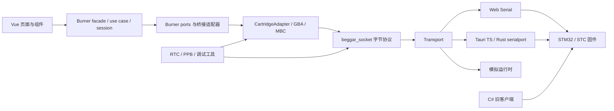

# Phase 0：审查基线

日期：2026-10-02。基线：`main` / `origin/main`，提交 `756179a`。

## 工作区与范围

- 已 fetch 并 fast-forward 到 GitHub 最新 main；审查时没有纳入用户未提交的修改。
- 用户修改与原有未跟踪文档完整保存在 `stash@{0}`，说明 `codex-pre-sync-2026-10-02`。不恢复、不删除。
- 覆盖 Web/Vue/TypeScript、Tauri/Rust、STM32、自编 STC 固件与旧 C# 客户端。第三方 HAL、USB 库、生成代码、原理图和 vendor 内容不做逐行审计。
- 本轮仅新增审查与方案文档，不修改业务实现、依赖配置、固件或测试。

## 实际架构

已有协议入口、领域端口、Transport、PlatformOps、FlashCommandSet、数据驱动设置和多菜单子组件。问题主要是操作所有权、资源退出语义、地址窗口和能力边界没有完整贯穿这些抽象，不宜推翻已有分层。

## 历史结论复核

- 4 月报告中的 shared constants、FlashCommandSet、PPB 公共流程、设置 descriptor、多菜单拆分、部分解析器拆分已存在，不重复立项。
- 7 月发现的连接生命周期队列、builder 配置污染/type 6、文件异步 latest-wins 已有对应修复与测试。旧 `fix-checklist.md` 仍全为未完成，不适合作为当前待办来源。
- 模块文档仍描述 Electron、已经不存在的 `serial-service` 和旧测试路径；当前运行时是 Web/Tauri/模拟。
- `openspec list --json` 返回空活动变更；本轮方案未自动创建实施 change。

## 验证记录

- 更新依赖前的检查作废：node_modules 对应旧锁文件；依赖安装与检查重叠造成文件占用。已停止检查并重新完成 `npm ci --ignore-scripts`，704 个包。
- 默认 Node 为 22.16.0，最新 jsdom 要求至少 22.22.2 或 24.15.0 等；实际验证直接使用本机 bundled Node 24.19.0。
- `cargo check --locked`：通过。
- Vite production build：通过（24.48 秒），有 gbats 的 fs externalization、Jimp eval 和大 chunk 警告。构建通过不代表模拟器功能已实测。
- 架构检查脚本：通过；只证明脚本定义的依赖约束成立，不能证明全部抽象合理。
- lint / 类型 / 单测最终结果见 summary，避免把执行中的检查当作通过。

## 证据强度

报告区分代码及内存最小复现确认的问题、结构债和待真机验证假设。没有真机烧写，不声明硬件验收通过；没有发布、推送或提交改动。
