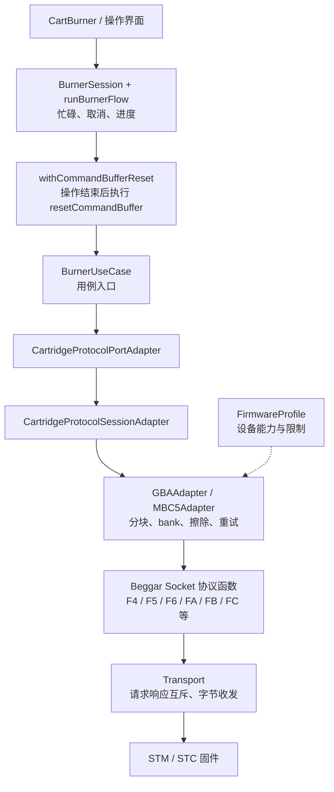

# 烧录器读写、设备与命令交互设计分析

- 分析日期：2026-11-17
- 代码基线：`f2e1f88` 的运行时代码及当前工作区。
- 范围：`web-client` 的连接、ROM/RAM 操作、设备能力、命令协议与串口传输；对照 STM/STC 固件命令处理。
- 性质：设计审查与简化建议，未修改运行时代码。
- 模型：GPT-6.1 Sol Created, GPT-6 Astra & Gemini 4 Argon & DeepSeek V4.1 Flash Reviewed.

## 1. 总体判断

**目前的主分层能支撑 STM「丐中丐」和 STC「碳酸丐」两类设备。已确认的问题包括：跨入口缺少整次设备操作互斥、`MBC5Adapter` 写入分块与校验流程存在实现缺陷、固件 profile 设置与当前连接的生效时机未在界面中明确表达；维护成本主要来自重复的卡带操作契约、半迁移的 `PlatformOps` 基类模板以及脱离生产调用链的旧接口。保持现有命令、响应和时序语义的设备较容易接入；新增卡带策略或不同协议仍需修改核心实现。**

改进与简化应围绕五项工作展开：修复 `MBC5Adapter` 写入与校验缺陷、补齐连接级互斥、统一连接状态与固件 profile 解析来源、处理半迁移适配器模板与死代码、合并重复卡带操作契约。保留应用接口的依赖隔离职责和设备差异所需的策略。

## 2. 变化维度与职责边界

| 变化维度 | 当前实现 | 应当负责的差异 | 评价 |
|---|---|---|---|
| 烧录器设备 | STM、STC，通过 `FirmwareProfile` 区分 | 固件命令能力、客户端传输限制 | 生产连接使用手动配置；设置变更在重连或重新初始化时应用，界面需明确该生效时机 |
| 卡带平台 | `GBAAdapter`、`MBC5Adapter`（内部还含 MBC3 等分支） | 地址映射、bank 切换、存档类型及所需供电流程 | 有必要，但流程重复较多，且 `MBC5Adapter` 的 `writeROM` / `verifyROM` 与 `GBAAdapter` 存在非预期偏差 |
| 运行环境 | Web Serial、Tauri、模拟设备 | 字节收发、控制线、连接关闭 | 抽象有效，应该保留 |

两类烧录器共用 Beggar Socket 命令协议的主体，GBA/MBC 读写实现可共享。现有实现按以下方式处理命令能力差异：

- GBA 扇区擦除统一通过 `rom_erase_sector()` 发送 `F5` 解锁序列并用 `F6` 轮询，所有 profile 的 `gbaSectorErase` 均为 `true`。发送专用 `F3` 命令的 `rom_erase_sector_direct()` 未被调用。
- 全片擦除由 `BurnerUseCase.eraseChip()` 计算物理扇区并调用 `eraseSectors()`。适配器原有 `eraseChip()` 及其调用的协议包装函数已脱离生产入口；其中 `rom_erase_chip()` 发送 `F1`，`gbc_rom_erase_chip()` 使用 GBC 透传命令。
- 5V 供电（`A0`）和 GBA FRAM（`E7/E8`）操作通过 profile 能力检查控制。

`MBC5Adapter` 包含 MBC3/MBC5 的 bank 策略；MBC1/2 的 ROM bank 切换及 MBC1 的 RAM bank 切换仍抛出未实现错误。[协议实现](../src/protocol/beggar_socket/protocol.ts)、[用例擦除实现](../src/features/burner/application/burner-use-case.ts)

**客户端 profile 的读取块上限为 STM 4 KiB、STC 32 KiB。** 仓库内 STM 固件把响应放入 `responBuf[5500]`；STC 固件使用 16 位读取长度并按端点 FIFO 分段发送。实际 ROM 读取还受 `AdvancedSettings.romReadPageSize`（默认 4 KiB；高级设置弹窗在挂载时加载并在保存时提交该字段，尚无独立编辑控件）、剩余长度和 bank 边界约束，例如 MBC 每次不跨 16 KiB 窗口；模拟设备另有放大逻辑块的分支。[profile 定义](../src/types/firmware-profile.ts)、[读取块计算](../src/services/cartridge-adapter.ts)、[高级设置弹窗](../src/components/modal/AdvancedSettingsModal.vue)、[STM 固件](../../mcu/chis_flash_burner/Core/Src/uart.c)、[STC 固件](../../stc/src/uart.c)

仓库内 STC 固件支持供电命令 `A0`，缺少 GBA FRAM 专用命令 `E7/E8` 和专用 GBA 扇区擦除命令 `F3`。因此，STC profile 配置为 `cartPowerControl: true`、`gbaSectorErase: true`、`gbaFramRam: false`。

## 3. 当前读写与命令交互

下图是烧录主流程；卡带工具、RTC 和调试工具另有直接调用服务及协议的路径，未统一经过 `BurnerSession` / `BurnerUseCase`。



- **读取 ROM**：稳定命令通道（`stabilizeCommandChannel`）→ 按读取上限与 bank 边界分块 → 切 bank（GBA 对大于 32 MiB 的卡带启用，MBC 按 16 KiB 窗口处理）→ 通过 `readROMChunkWithRetry()` 发送读取命令并获取数据 → 失败时复位通道并恢复 bank 后重试。
- **写入 ROM**：按目标长度准备镜像，必要时用 `0xFF` 补齐 → 计算与目标区间相交的物理扇区 → 调用 `eraseSectors()` 擦除 → 分块发送编程命令并等待 ACK（全 `0xFF` 块跳过编程）→ 可重试的编程失败发送 Flash reset（`0xF0`）、重新擦除当前扇区并从扇区内的写入起点重放。部分覆盖扇区时会擦除目标区间外的头尾数据，目前只记录警告，不做读改写保留。**MBC 写入误用读取分块设置，具体触发条件与影响见第 4.2 节。**
- **校验 ROM**：写入和校验是独立入口。`GBAAdapter.verifyROM()` 先执行 `stabilizeCommandChannel()`，再通过 `readROMChunkWithRetry()` 分块读取比对；`MBC5Adapter.verifyROM()` 直接调用 `gbc_read()`，其供电与读取恢复缺口见第 4.2 节。
- **命令层**：负责组包、地址和长度字段、ACK 与读取响应；底层 Transport 隔离浏览器、Tauri 与模拟设备的通信差异。

分块规划、物理扇区计算，以及写失败后按扇区恢复，都有真实硬件约束支撑，应当保留。[transfer-plan.ts](../src/utils/transfer-plan.ts)、[GBA 写入流程](../src/services/gba-adapter.ts)、[MBC 写入与校验流程](../src/services/mbc5-adapter.ts)

## 4. 主要发现

### 4.1 设备操作的互斥边界不完整

当前有两种保护：

- `BurnerSession.busy` 避免同一个烧录界面重复启动操作；
- `Transport.sendAndReceive()` 的互斥锁避免单条命令与响应交错。

这两层保护都有价值，但“切 bank → 读取数据”由多条命令组成，Flash 解锁、擦除、轮询以及 5V 上下电也是一组命令。**单条请求响应互斥，无法保证整组操作期间设备状态不被其他入口改变。**

卡带工具（包含 RTC、震动、PPB 解锁）使用自己的 `busy`，调试工具使用自己的 `isSending`，连接组件 `DeviceConnect` 使用自己的 `isConnecting` / `isProcessing`，均不共享烧录会话的状态。`HomeView` 把同一个 `device` 传给 `CartBurner` 和 `AppMenu`，而 `AppMenu` 和 `DeviceConnect` 没有接收烧录 busy 状态。因此可达触发路径包括：开始 ROM 读写 → 从菜单打开卡带工具执行 RTC/震动/PPB 操作、打开调试工具发送命令，或在读写途中点击“重置连接状态”/“断开连接”。[页面装配](../src/views/HomeView.vue)、[工具菜单](../src/components/common/AppMenu.vue)、[卡带工具执行入口](../src/components/modal/CartridgeToolsModal.vue)、[连接组件](../src/components/DeviceConnect.vue)

此外，以下路径直接绕过了 `Transport.sendAndReceive()` 的请求响应锁：

- 调试命令 `executeDebugCommand()` 分别调用 `sendPackage()` 和 `getPackage()`；
- `sendAndExpectAck()` 在 `sendAndReceive()` 释放锁之后才调用 `flushInput()`；
- 供电控制 `cart_power()` 直接调用 `sendPackage()`，随后 `setCartPower()` 直接调用 `setSignals()`；
- 通道复位 `resetCommandBuffer()` / `stabilizeCommandChannel()` 直接调用 `flushInput()`、`setSignals()` 和 `drainInput()`。

锁只保护调用 `sendAndReceive()` 的单次收发，不能阻止上述旁路读写、信号线翻转或缓冲清理干扰在途命令。[Transport 接口](../src/platform/serial/types.ts)、[调试命令入口](../src/services/debug-protocol-service.ts)、[ACK 清理](../src/protocol/beggar_socket/protocol-utils.ts)、[供电操作](../src/services/mbc5-adapter.ts)、[通道复位](../src/services/cartridge-adapter.ts)

**静态调用链确认这些入口可并发访问同一连接。** 并发操作可能改变 bank、Flash 状态机、供电状态或响应归属，进而干扰在途读写。

建议让**同一连接共享一个操作入口**，在最外层获取所有权，覆盖整次读写、工具操作、连接重置及结束清理；内部的嵌套调用（如 `writeROM → eraseSectors`、`verifyRAM → readRAM`、免电存档读写 → `eraseSectors` / `readBatterylessSave`、PPB 解锁 → `getCartInfo` / `switchROMBank`）复用当前所有权，避免重入死锁。底层 `Transport` 互斥锁继续保留。

调试请求可改用已有 `sendAndReceive()`。ACK 后的 `flushInput()` 要与对应请求共用 Transport 内部临界区，需要扩展原子操作契约，例如增加受控的读后清理选项或事务接口，并同步实现 Web、Tauri 和模拟 Transport。采用事务接口时，锁内应调用不重复获取同一把锁的收发原语，避免嵌套调用 `sendAndReceive()` 造成死锁。

统一入口应返回可识别的 busy 结果，UI 共享忙碌状态并禁用冲突入口；仍到达执行入口的请求被拒绝时，应提供可见反馈。当前 `executeOperation()` 在 busy 时直接返回 `undefined`，烧录界面的读写按钮则已有 busy 禁用条件。[执行入口](../src/composables/cartburner/useCartBurnerSessionState.ts)、[烧录按钮](../src/components/operaiton/RomOperations.vue)

取消与清理时序方面：`BurnerSession.abortOperation()` 会保持 `busy = true` 直至操作 Promise 结束（`BurnerSession.runWithTimeout()` 仅有单元测试调用，未接入生产代码）。`CartBurner.vue` 目前把 `withCommandBufferReset()` 包在传给 `executeOperation()` 的 `operation` 回调内部（即 `runBurnerFlow()` 的 `execute` 阶段内），因此在烧录主界面中 `resetCommandBuffer()` 先于 `completeOperation()` 执行；但 `runBurnerFlow()` 自身的 `finally` 块是先调用 `completeOperation()` 再执行 `onFinally`。收敛为统一连接级入口后，必须保证命令缓冲复位与恢复默认 3.3V 供电等清理动作在释放连接所有权之前完成。[会话状态](../src/features/burner/application/burner-session.ts)、[流程生命周期](../src/features/burner/application/flow-template.ts)、[CartBurner 清理包装](../src/components/CartBurner.vue)

### 4.2 `PlatformOps` 处于半迁移状态且子类实现存在偏差

生产主路径执行 `GBAAdapter` / `MBC5Adapter` 子类的 `readROM()` 和 `getCartInfo()`。基类 `CartridgeAdapter` 中的两个同名模板均被子类覆盖且无 `super` 调用。`withPowerConfig()` 仅由这些未启用模板调用，其中 MBC 子类覆盖该钩子，GBA 使用基类默认实现。这些代码形成了两份生产读取实现和一份未启用模板的维护冗余。

当前复用与死代码情况：

- 两个子类仅在 `readROM()`（以及 `GBAAdapter.verifyROM()`）中共享 `readROMChunkWithRetry()`，通过 `this.ops.flashCmdSet.read` 执行分块读取；
- 基类 `readROM()`、`getCartInfo()` 模板与 `withPowerConfig()` 在生产路径中未被调用；
- `PlatformOps.romProgram`、`romEraseSector` 没有任何调用方；
- `CartridgeAdapter.eraseChip()`、`GBAAdapter.eraseChip()`、`MBC5Adapter.eraseChip()` 以及协议层 `rom_erase_chip()`、`gbc_rom_erase_chip()`、`rom_erase_sector_direct()` 组成了生产入口不可达的旧擦除链路：子类 `eraseChip()` 仍调用对应协议函数，`BurnerUseCase.eraseChip()` 则走 `eraseSectors()`。调试工具通过命令枚举构造原始请求，独立于这些包装函数。

提交 `ddd285d` 引入了 Phase A 的策略与模板基础设施。读取模板统一需保留下列平台行为：[基类模板](../src/services/cartridge-adapter.ts)、[PlatformOps](../src/services/platform-ops.ts)、[MBC 子类实现](../src/services/mbc5-adapter.ts)

- **地址映射**：MBC3 的 bank 0 从 `0x0000` 读取，MBC5 的 bank 0 从 `0x4000` 读取。`MBC5Adapter.romBankRelevantAddress()` 根据 `mbcType` 选择基址，但 `MBC5Adapter.createPlatformOps().toRomBank()` 忽略了 `options.mbcType`，固定使用 `'MBC5'` 映射。
- **供电能力前置检查**：请求 5V 时，`MBC5Adapter.readROM()` 和 `getCartInfo()` 在记录开始日志、进入 `PerformanceTracker` 和调用 `withOptional5v()` 之前，会先检查 `this.firmwareProfile.capabilities.cartPowerControl` 并在不支持时立即拒绝；基类模板没有该检查，直接进入 `withPowerConfig()` 会在不支持 5V 的固件上发送 `A0` 命令。
- **读取节流与默认参数**：子类中仅 `GBAAdapter.readROM()` 应用 `AdvancedSettings.romReadThrottleMs` 且提供默认参数 `size = 0x200000`，`MBC5Adapter.readROM()` 不应用该节流；基类模板对两个平台无条件应用 `romReadThrottleMs`。

同时，`MBC5Adapter` 存在以下写入与校验问题：

- **校验没有执行请求的 5V 供电。** `verifyROM(enable5V: true)` 只检查能力，未调用 `withOptional5v()`。主界面的 5V 开关会传入校验操作，需要 5V 的卡带在独立校验时仍使用当前供电状态；应让校验过程拥有完整的供电切换与恢复生命周期。
- **校验缺少读取稳定化与重试。** 校验前未调用 `stabilizeCommandChannel()`，分块读取直接调用 `gbc_read()`。单块读取抛出异常时直接结束校验，配置的 `romReadRetryCount` 不生效。应复用读取恢复流程，并在通道复位后恢复当前 bank。
- **写入分块忽略了写入设置。** `writeROM()` 调用 `resolveRomReadPageSize()`，主界面写入又未传入 `options.romPageSize`，因此用户通过高级设置将 `AdvancedSettings.romPageSize` 调小到 512 B 或 1 KiB 后，MBC 写入仍按默认读取设置使用 4 KiB 块。这个设置失效问题可通过现有 UI 触发。
- **非默认读取配置可使 STC 写入超限。** `romReadPageSize` 默认为 4 KiB，当前弹窗没有独立编辑控件；通过持久化配置或程序化设置将其增大到 ≥ 8 KiB 后，在 STC profile、调用方未指定更小页大小，且数据、bank 和扇区剩余空间足够时，会产生 8 KiB 或 16 KiB 编程块，超过固件 `cmdBuf[5500]` 的接收容量。STC 的 `uart_cmdRecv()` 在剩余空间不足时直接返回，接收可能停滞并使主机等待超时，需要复位通道恢复。默认读取配置下块长为 4 KiB；STM profile 也将读取块限制为 4 KiB。[固件接收实现](../../stc/src/uart.c)

写入修复应改用 `resolveRomPageSize()`，使块长遵守写入设置。当前 4 KiB 上限由设置层 `pageSize.max = 0x1000` 保证，配置加载、`setSettings()` 和属性 setter 均经过校验；解析函数再按调用方请求与已校验设置取较小值。验证应覆盖更小写入设置生效，以及读取设置增大后真实设备编程块仍 ≤ 4096 字节。模拟设备保留独立的块长放大分支。[设置校验](../src/settings/advanced-settings.ts)、[写入块解析](../src/services/cartridge-adapter.ts)

建议先修复 `MBC5Adapter.verifyROM()` 的供电与读取恢复，再修复 `writeROM()` 的分块设置；随后若继续推进读取模板统一，需先补齐上述三处平台差异并用命令序列测试验证；若暂不迁移，应直接删除基类未启用的 `readROM()` / `getCartInfo()` / `withPowerConfig()`、`PlatformOps` 中无调用方的 `romProgram` / `romEraseSector`，以及脱离生产链路的 `eraseChip` 相关死代码。

### 4.3 用例与适配器之间存在重复接口和结果转换

一次写 ROM 会依次经过：

```text
BurnerUseCase.writeRom
→ BurnerProtocolPort.writeRom(session, ...)
→ BurnerProtocolSession.writeROM(...)
→ CartridgeAdapter.writeROM(...)
```

其中 `CartridgeProtocolSessionAdapter` 逐方法原样转发；`CartridgeProtocolPortAdapter` 再包一层结果和错误。`BurnerProtocolPort` 和 `BurnerProtocolSession` 重复描述了主要卡带能力，各有一套生产包装实现；底层 `CartridgeAdapter` 有 GBA/MBC 两个生产子类，并额外提供 `eraseChip()` 等方法。

卡带操作结果经历以下往返转换：

```text
CommandResult
→ BurnerDomainResult<CommandResult>
→ CommandResult
```

适配器将已捕获的异常转为 `CommandResult { success: false, message }`，消息可能是本地化文本，也可能包含原始英文错误。`normalizeCommandResult()` 再构造 `new Error(result.message)`，丢失原始异常类型与代码；此时 `mapDomainError()` 主要按消息中的英文子串分类，未命中时返回 `'runtime_error'`；在 `readCartInfo()` 中，当 `getCartInfo()` 返回 `false` 时还会被固定替换为 `'No cart info returned'`，丢失底层记录的具体原因（如 5V 不支持或 CFI 解析失败）。随后 `BurnerUseCaseImpl` 的 `toCommandResult()` 又丢弃 `stage / code / cause / recoverable`，转回只有 `{ success, message }` 的 `CommandResult`。[会话与结果包装](../src/features/burner/adapters/cartridge-protocol-port.ts)、[错误分类](../src/features/burner/application/domain/error-mapping.ts)、[用例结果转换](../src/features/burner/application/burner-use-case.ts)

连接编排消费连接端口返回的 `BurnerDomainResult`，将失败转换为 `ConnectionFailure`；它还会自行产生 `selection_required`、`stale_context` 等连接失败，`DeviceConnectionManager` 使用这些结果处理选端口与错误展示。连接错误契约应保留，卡带操作链路的重复接口和结果转换应单独收敛。[连接错误处理](../src/services/device-connection-manager.ts)

建议保留一个由应用层定义的卡带操作契约，由 GBA/MBC 适配器直接实现或通过单层适配接入；把连接有效性检查保留在会话上下文中，去掉 `CommandResult → BurnerDomainResult<CommandResult> → CommandResult` 的重复结果包装及错误信息丢失。该契约继续承担应用层依赖隔离和测试替身入口职责，`BurnerUseCase` 保留读卡信息组织、全片擦除扇区计算、多卡扫描这些实际编排职责。[依赖检查规则](../scripts/check-architecture-deps.cjs)

### 4.4 连接信息重复存储，固件配置的生效时机不明确

`DeviceInfo` 和内部 `device.serialHandle`（`DeviceHandle`）重复持有 `port`、`transport`、`portInfo`、`firmwareProfile` 引用；`DeviceConnectionManager` 和 `attachFirmwareProfile()` 需要同步更新两处字段。部分消费者读取 `device.transport ?? device.serialHandle?.transport`，而 `resetCommandBuffer()` 只读顶层 `this.device.transport` 并在为空时回退到 `this.device.port`；断开连接时 `disconnectDevice()` 清空了 `connection / port / transport / serialHandle`，但保留了 `portInfo / firmwareProfile`。多处可变字段与不一致的读取回退路径构成状态一致性风险。[DeviceInfo 定义](../src/types/device-info.ts)、[DeviceHandle 定义](../src/platform/serial/types.ts)、[适配器读取与复位路径](../src/services/cartridge-adapter.ts)

固件 profile 的当前决策与生效规则如下：[配置覆盖推断](../src/services/device-connection-manager.ts)、[profile 解析](../src/types/firmware-profile.ts)

1. **生产连接采用手动配置。** `AdvancedSettings.firmwareProfile` 取 `'stm' | 'stc'`，默认为 `'stm'`。`DeviceConnectionManager` 建立或初始化连接时，将该设置解析为有效 profile 并写入设备对象。端口推断用于连接日志以及缺少已附加 profile 的设备对象的 fallback。两类设备可能共用 VID/PID，手动选择应保留。
2. **设置变更在重连或重新初始化时应用。** `getFirmwareProfile(device)` 优先读取连接时写入的 `device.firmwareProfile ?? device.serialHandle?.firmwareProfile`。用户在设备已连接状态下打开高级设置切换 STM/STC 并保存时，仅更新了 `AdvancedSettings.firmwareProfile`，未同步更新当前 `device.firmwareProfile`，必须断开重连或点击“重置连接状态”才会生效。

`withPortInfo()` 当前在更新端口信息时，还会将 `device` 和 `serialHandle` 的 profile 改为端口推断值；`connectWithSelectedPort()` 随后调用 `attachFirmwareProfile()` 才恢复手动配置。该顺序依赖可先局部消除：让 `withPortInfo()` 只更新端口信息，将 profile 的解析与附加职责集中到连接初始化流程。

连接编排已在 `ConnectionContext` 和快照中维护 generation，但 `DeviceInfo`、`toDeviceInfo()` 及卡带操作链路尚未接入该标识。当前卡带会话的 `isActive` 只检查页面连接状态。需要在创建操作上下文时显式捕获连接 generation 或连接身份，并在执行时与当前连接比较，使旧会话在重连后保持失效。[连接上下文](../src/features/burner/application/domain/connection.ts)、[卡带会话装配](../src/components/CartBurner.vue)

建议由连接上下文唯一持有 transport、端口信息及本次连接的有效 profile，并向操作链路提供连接生命周期校验。设置面板应显示当前生效 profile，并说明修改需重连或重新初始化。若提供对当前连接的应用操作，应在设备空闲时经统一操作入口更新，并为整次设备操作固定有效 profile。自动识别可作为独立产品选项评估；现有手动模式可继续使用。

## 5. 扩展性评估

| 扩展场景 | 当前难度 | 判断 |
|---|---|---|
| 增加第三种、共用现有命令及响应/时序语义的烧录器 | 较低到中等 | 差异可由现有能力字段表达时，可沿用适配器；修改范围包括 profile ID、配置校验与选择 UI、端口发现及测试 |
| 给现有设备增加一条底层命令 | 较低 | 命令枚举、组包函数与测试比较直接 |
| 把新命令作为完整业务操作开放 | 中等偏高 | 需要穿过多套重复接口与转发层 |
| 增加卡带类型或 bank 策略 | 取决于差异范围 | 单纯增加已知 bank 映射可局部修改；涉及新存档、编程或供电流程时成本较高。现有 MBC1/2 分支仍未完成 |
| 接入完全不同的设备协议 | 较高 | 高层接口可以复用，但当前卡带算法直接调用 Beggar Socket 协议函数 |

因此，**目前适合接入命令、响应和时序兼容、且能力差异可由 profile 表达的设备，尚未形成方便替换协议后端的架构。** 当前应优先修复现有实现偏差，并围绕 profile、Transport 和卡带策略收敛扩展点。

## 6. 建议的目标结构

```text
UI（CartBurner / 卡带工具 / 调试工具 / 连接控制）
→ 连接级操作入口：跨入口互斥、嵌套调用复用所有权、在途取消、结束清理（含缓冲复位与供电恢复）
→ BurnerUseCase / 工具服务：业务编排
→ 单一卡带操作契约：GBA / GB-MBC 策略与已验证的共用流程
→ Beggar Socket 协议：组包、原子收发（含 ACK 后清理）、协议错误
→ Transport：Web / Tauri / 模拟字节通道

连接上下文统一持有：transport、portInfo、有效 profile、操作状态
操作上下文捕获并校验：连接 generation 或连接身份
```

RTC、卡带工具与调试服务可保留自己的业务入口，但必须经过同一连接级操作入口。应用层依赖单一卡带操作契约，具体适配器由外部装配。操作上下文绑定所属连接的生命周期；连接断开或重连更换后，旧上下文立即失效。

## 7. 建议实施顺序与验证依据

| 顺序 | 工作项 | 需要保留/修正的行为 | 最小关键验证 |
|---|---|---|---|
| 1 | 修复 MBC `verifyROM` 的供电、稳定化与重试 | `enable5V` 时包裹 `withOptional5v`；读前稳定通道，读取失败后复位并恢复 bank 再重试 | 验证 5V 校验发送正确的供电切换与默认供电恢复序列；覆盖成功、失败、取消后的清理，以及单块读取失败重试 |
| 2 | 修复 MBC `writeROM` 页大小计算 | 使用写入页大小解析，遵守已校验的写入设置与调用方更小限制；真实设备写入设置上限为 4096 字节 | 写入设置为 512 B / 1 KiB 时验证块长匹配；人工设 STC 读取块为 32 KiB 且不传调用方页大小，验证编程块仍 ≤ 4096 字节 |
| 3 | 统一连接级操作所有权与 Transport 原子操作能力 | 覆盖烧录、工具、调试、连接重置/断开及结束清理；扩展原子操作契约以覆盖 ACK 后清理，同步三个 Transport 实现；嵌套调用复用所有权 | 暂停读取后尝试其他操作，确认 busy 结果及可见反馈；验证清理完成前不释放所有权、ACK 清理不干扰下一请求、嵌套调用不死锁 |
| 4 | 统一连接信息来源，明确 profile 生效时机并接入连接生命周期校验 | `withPortInfo` 只更新端口信息；保留手动 profile 及生效提示，整次操作内 profile 固定；操作上下文捕获 generation 或连接身份；读取块配置控件按需求补齐 | 验证更新端口信息保留有效 profile，重连/初始化应用新设置；确认旧会话在新设备连接后仍被拒绝，已有读取块设置正常保存 |
| 5 | 处理 `PlatformOps` 半迁移状态并清理旧链路 | 统一读取时保留 MBC3/MBC5 地址映射、5V 能力检查、节流差异与默认参数；移除无调用方字段及未使用的擦除包装 | 对比 GBA、MBC5、MBC3 命令序列；覆盖 bank 边界、读取重试、STM 拒绝 5V、STC 供电恢复及 MBC1/2 未实现错误 |
| 6 | 合并重复卡带操作接口和结果表达 | 保留用例编排、会话活性检查、应用层依赖隔离及连接错误契约 | 验证成功、超时、取消、断连和能力不支持的上层结果，包括 `readCart` 失败原因；运行架构依赖检查 |

每一步单独验证。写入、RAM 和供电流程继续按实际差异逐项评估，避免一次性扩大模板接口。

## 8. 已执行验证与限制

2026-11-17 在 `web-client/` 执行：

```sh
npm run test:run -- tests/services/adapters tests/features/burner tests/protocol tests/platform/serial tests/utils/firmware-profile.test.ts tests/utils/transfer-plan.test.ts tests/services/device-connection-manager.test.ts
```

结果：**17 个测试文件、131 项测试全部通过**。覆盖适配器、烧录用例、协议、串口、固件 profile、分块规划与连接管理器的相关测试。

验证覆盖现有软件行为基线。跨入口并发可达性、连接配置生效规则与旧擦除链路的调用范围已通过代码与调用链静态核查；浏览器并发复现、真机传输时序与大块读取可靠性尚待实机验证。另用临时 mock 测试完成了 4 项行为核验：

- 人工设置 `romReadPageSize = 0x8000`、`romPageSize = 0x100`，不传调用方页大小，STC profile 下产生 16 KiB 编程块。
- 使用相同设置，STM profile 下产生 4 KiB 编程块，忽略 256 B 写入设置。
- MBC 校验设置 `enable5V: true`，没有调用供电控制和读前命令缓冲复位。
- 配置读取重试次数为 2，MBC 校验仍在首次读取异常后结束。

4 项结果均与上述实现分析一致，临时测试已移除。建议方案实施时，按第 7 节补充修复后的行为与命令序列回归测试。

## 9. 相关实现与设计记录

- [固件能力与 profile](../src/types/firmware-profile.ts)
- [设备连接管理器](../src/services/device-connection-manager.ts)
- [应用端口契约](../src/features/burner/application/domain/ports.ts)
- [卡带操作适配与结果转换](../src/features/burner/adapters/cartridge-protocol-port.ts)
- [烧录会话与取消状态](../src/features/burner/application/burner-session.ts)
- [平台策略接口](../src/services/platform-ops.ts)
- [GBA 适配器实现](../src/services/gba-adapter.ts)
- [MBC 适配器实现](../src/services/mbc5-adapter.ts)
- [STM 固件命令处理](../../mcu/chis_flash_burner/Core/Src/uart.c)
- [STC 固件命令处理](../../stc/src/uart.c)
- [适配器模板方法历史设计](../../openspec/changes/archive/2025-07-14-adapter-template-method/design.md)
- [读写流程加固设计](../../openspec/changes/harden-web-client-burner-workflows/design.md)
