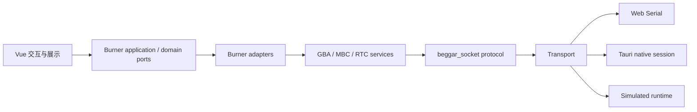

# 模块总览

当前范围为 Vue 3 + TypeScript + Vite 的 Web Client，以及 Tauri 桌面运行时。调试模式使用同一协议接口驱动模拟设备。

`src/features/burner/application/` 管理操作与连接生命周期，`src/features/burner/adapters/` 接入硬件实现。`src/types/` 和 `src/utils/` 承载共享契约与纯规则；`src/services/` 仍包含卡带硬件策略和独立 RTC/LK 子域。

设备所有权由 `src/features/burner/application/device-operation-owner.ts` 统一：同一 transport 的页面、工具和断连共享独占权。取消提出请求，真实 worker 与 cleanup 完成后才能释放；失败 close 保留资源供重试。

架构门禁入口为 `scripts/check-architecture-deps.cjs`。TS AST、Vue script 和 module resolution 检查 alias/relative/dynamic/re-export/type 边；运行时循环单独检查。非字面量计算 import 不在静态解析覆盖内。ESLint 限制与脚本边界均须通过，绿灯不能代替行为验收。

质量命令（在 web-client 目录）：

- `npm run lint`
- `npm run type-check`
- `npm run check:deps`
- `npm run test:run`
- `npm run build`

CI 基线 Node 24.19.0 / npm 11.19.0；`.github/workflows/check-webclient.yml` 提供 quality 与 Windows native check/test。Web/Tauri 打包依赖该工作流；GitHub 分支保护 required status 是否配置，尚未验收。

当前修复证据与剩余验收见[状态报告](../../../docs/review-2026-10-02/current-finding-status.md)。新增核心入口须更新相应模块文档与合同测试。
