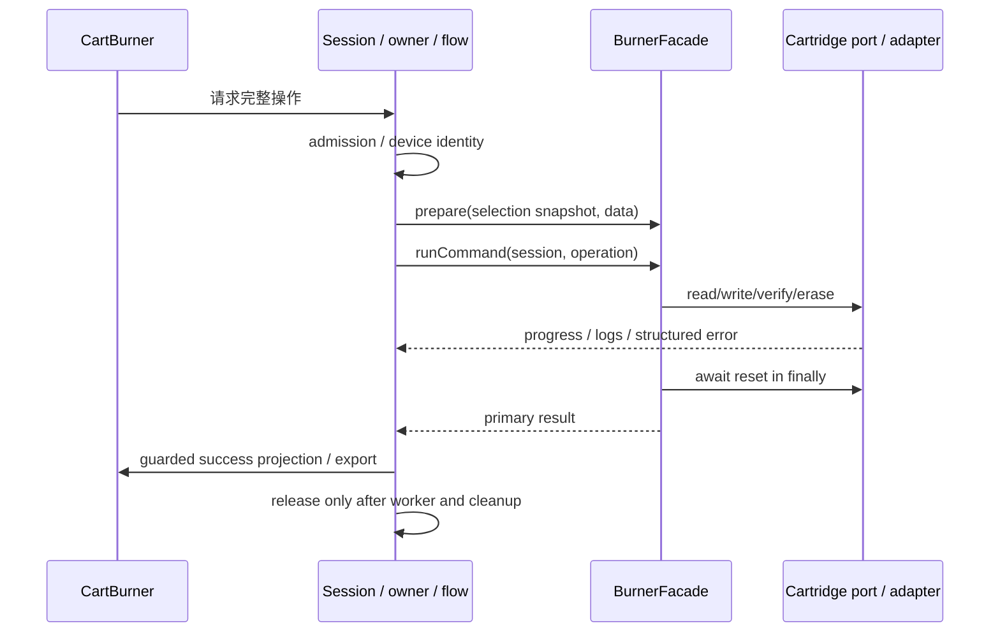

# 模块：关键数据流

## 连接

DeviceConnect → DeviceConnectionManager → ConnectionOrchestrationUseCase → DeviceGateway → DeviceHandle/Transport。连接生命周期排队，指定新端口先确认旧资源成功 close 再 open/init；发现失败不改变 handle 所有权。断连经 owner 关闭 admission、取消并 drain 当前真实事务，失败保留清理入口。

## ROM/RAM 操作

取消将 signal 标为 aborted；旧进度/finally/结果不能写入新会话。导出文件名选择和 save 属于 UI，依然在真实操作流程中 await，设备所有权不会先释放。

## 构建与文件

RomAssembly → rom-assembly store → Home consumeResult；MultiMenu 用户选择/default fetch → latest-wins/disposed guard → BuildInput → 局部 LK context → prepared/allocated → 二进制输出。背景存在时才加载 imageUtils；默认背景与页面预加载行为保留。

## 协议与诊断

adapter → protocol → Transport → Web/native/simulated；精确长度、ACK、CRC、bank/sector 规则分别由对应边界检查。CommandError 的 cause/stage/code/operation/address/cleanupError 经过 domain result 和 facade 保留到会话 diagnostic，UI message 兼容原翻译。
